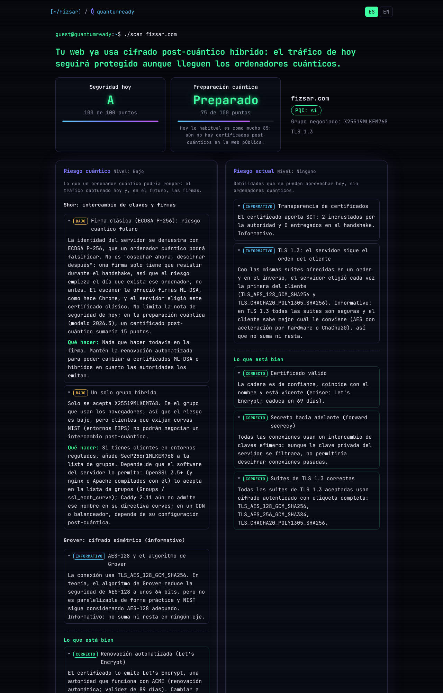
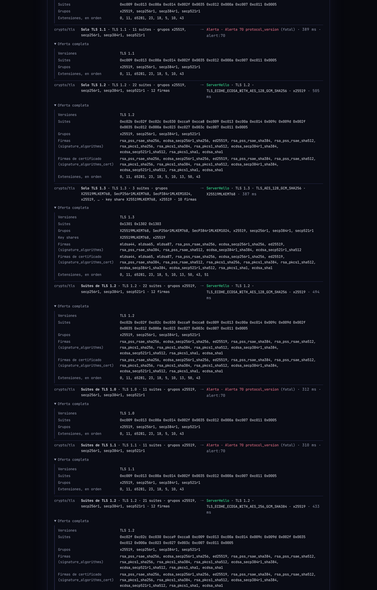
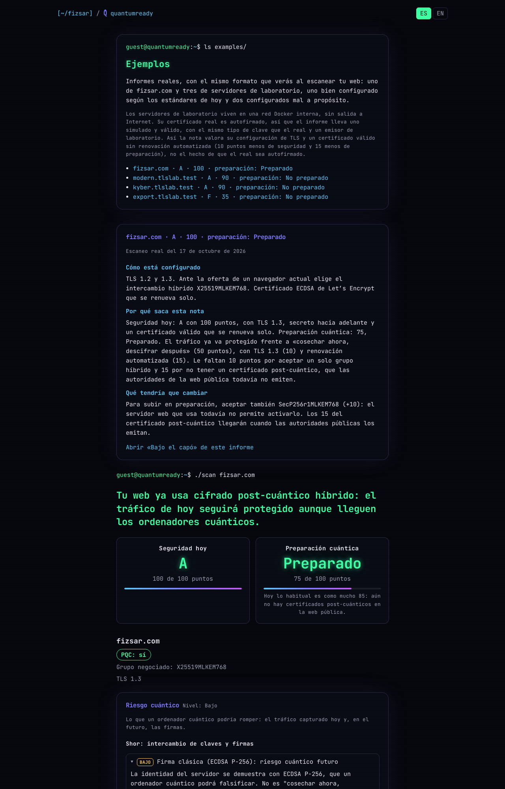

# QuantumReady

[](https://github.com/fizsar/quantumready-saas/actions/workflows/ci.yml)
[](LICENSE)

[EN](README.md) · **ES**

QuantumReady comprueba cómo cifra una web sus conexiones y lo preparada que está para la criptografía post-cuántica: si ya ofrece intercambio de claves híbrido con ML-KEM, qué versiones de TLS y suites de cifrado acepta y qué certificado presenta. El resultado es un informe en lenguaje claro, en español o en inglés, con todas las sondas que hizo a la vista en «Bajo el capó».

**Pruébalo:** https://quantumready.fizsar.com — escanea cualquier dominio (sin cuenta, con una prueba de trabajo en tu navegador; los resultados se guardan 30 días). Cómo se comporta el escáner, desde qué IP analiza y cómo excluir tu dominio: [/about-scans](https://quantumready.fizsar.com/about-scans).

**Estado:** proyecto de portfolio, en producción y mantenido por una persona. El escaneo público está abierto; no hay cuentas ni pagos. El repositorio contiene también código de cuentas, organizaciones y dominios verificados, apagado en producción.

| Informe | Bajo el capó | Ejemplos del laboratorio |
|---|---|---|
|  |  |  |

## Qué mide

Dos notas separadas, para no confundir una web moderna pero aún no post-cuántica con una insegura:

- **Seguridad hoy** (A–F): TLS 1.3, secreto hacia adelante y el certificado, con topes para lo que está roto (SSLv2/v3, cifrados de exportación o NULL, Diffie-Hellman débil…).
- **Preparación cuántica** (0–100): intercambio de claves post-cuántico híbrido (X25519MLKEM768 y otros), TLS 1.3, variedad de grupos, renovación del certificado y certificados post-cuánticos (ML-DSA, SLH-DSA). Aceptar un borrador obsoleto de Kyber resta.

El modelo, sus pesos y las referencias de cada tope están en [docs/scoring.md](docs/scoring.md).

## Cómo funciona

- **Escáner** ([internal/scanner](internal/scanner)): `crypto/tls` de Go para los handshakes reales (habla X25519MLKEM768 de forma nativa) y ClientHello construidos a mano ([internal/scanner/rawtls](internal/scanner/rawtls)) para lo que `crypto/tls` no ofrece (SSLv2/v3, suites antiguas, grupos concretos, el ClientHello exacto de Chrome). Las sondas en crudo solo leen la primera respuesta del servidor y nunca completan el handshake. Sus analizadores tienen fuzzing.
- **Validación**: un laboratorio Docker de servidores débiles a propósito, en una red interna ([test/tlslab](test/tlslab)), comparado con testssl.sh; resultados en [docs/validation.md](docs/validation.md).
- **Servicio**: una API y un worker en Go, PostgreSQL como cola (`FOR UPDATE SKIP LOCKED`, concesiones), y una web en React + TypeScript. Anti-SSRF (sin direcciones privadas ni reservadas; los nombres se resuelven una vez y se fijan), límites por cliente, por dominio y globales, prueba de trabajo autoalojada, lista de exclusión, y seguridad por filas con roles de base de datos de mínimo privilegio. Detalle: [docs/scanner.md](docs/scanner.md), [docs/api.md](docs/api.md), [docs/security.md](docs/security.md).
- **Arquitectura**: https://quantumready.fizsar.com/architecture

## Ejecutarlo en local

Requisitos: Go (la versión de [go.mod](go.mod)), Node 24, Docker y make.

```sh
make dev     # PostgreSQL (Docker), Mailpit, la API (:8080), el worker, el mailer y la web en http://localhost:5173
make test    # tests de Go (también los de integración si la base de datos de desarrollo está en marcha) y de la web
make lint    # golangci-lint, oxlint y tsc
make build   # bin/ (api, migrate, worker, mailer, qradmin, qrscan) y web/dist
```

`make dev` crea `.env` a partir de [.env.example](.env.example) la primera vez: valores solo para local, nunca secretos de producción. Por defecto solo escanea los dominios de `SCAN_ALLOWLIST`; con `PUBLIC_SCAN_OPEN=true` (y `ALTCHA_HMAC_KEY`) se prueba el escaneo abierto.

Un escaneo desde la terminal, sin el servicio:

```sh
go run ./cmd/qrscan example.com
go run ./cmd/qrscan -lang es -facts example.com
```

El laboratorio TLS (siempre en una red Docker interna): `make tlslab-up`, `make tlslab-test`, `make tlslab-down`.

## Repositorio

`cmd/` (api, worker, migrate, mailer, qradmin, qrscan), `internal/` (scanner, scoring, report, store, httpapi…), `migrations/`, `web/`, `deploy/` (el compose de producción y los scripts de despliegue y copias), `docs/` (notas de diseño y ADR), `test/tlslab/`.

## Seguridad

Las vulnerabilidades, en privado: ver [SECURITY.md](SECURITY.md).

## Contribuir

Ver [CONTRIBUTING.md](CONTRIBUTING.md).

## Licencia

[AGPL-3.0-only](LICENSE). Copyright (C) 2026 Fiz Sar López. Si ofreces una versión modificada como servicio en red, la AGPL te pide ofrecer su código fuente a sus usuarios.
