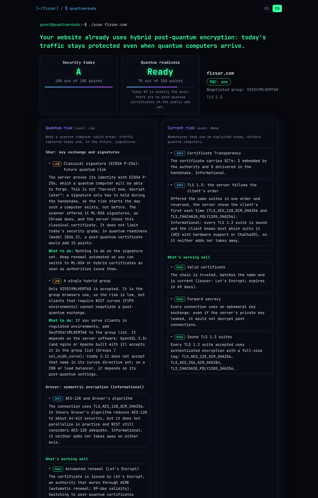
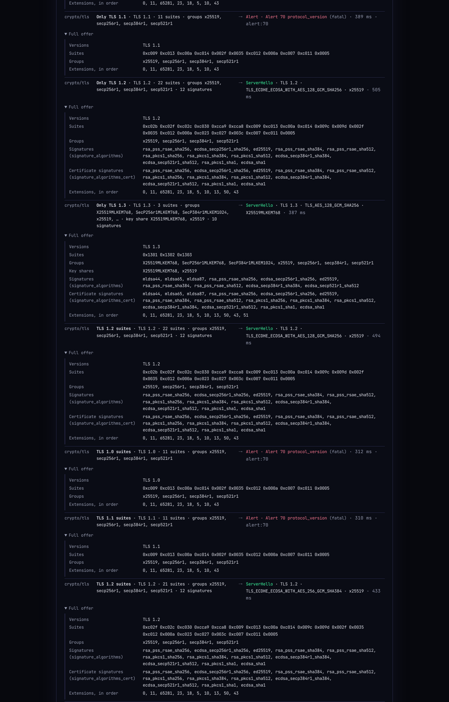
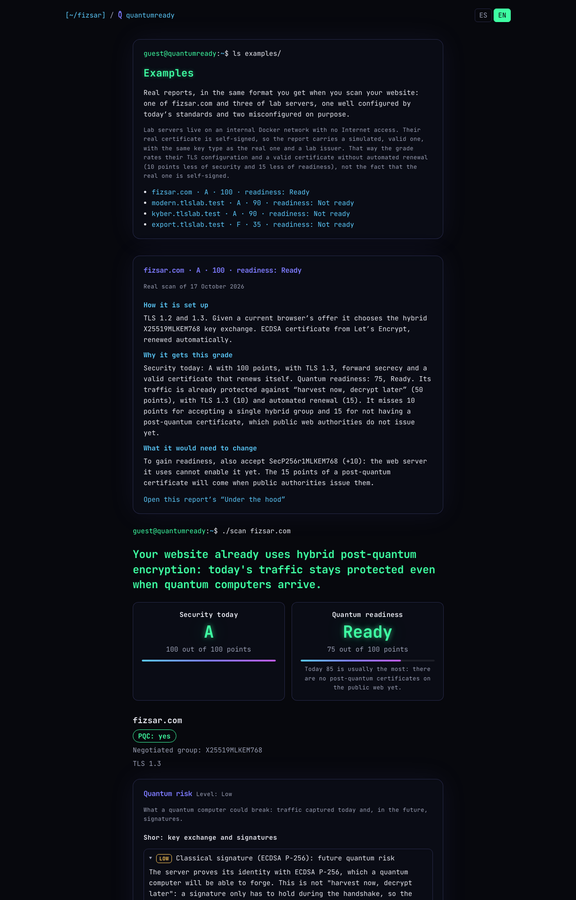

# QuantumReady

[](https://github.com/fizsar/quantumready-saas/actions/workflows/ci.yml)
[](LICENSE)

**EN** · [ES](README.es.md)

QuantumReady checks how a website encrypts its connections and how ready it is for post-quantum cryptography: whether it already offers hybrid ML-KEM key exchange, which TLS versions and cipher suites it accepts, and what certificate it presents. The result is a plain-language report in English or Spanish, with every probe it made available under the hood.

**Try it:** https://quantumready.fizsar.com — scan any domain (no account, a proof of work in your browser, results kept 30 days). How the scanner behaves, which IP it scans from and how to exclude your domain: [/about-scans](https://quantumready.fizsar.com/about-scans).

**Status:** a portfolio project, run in production by one person. Public scanning is open; there are no accounts or payments. The repository also contains code for accounts, organizations and verified domains, switched off in production.

| Report | Under the hood | Lab examples |
|---|---|---|
|  |  |  |

## What it measures

Two separate scores, so that a modern but not yet post-quantum site is not confused with an insecure one:

- **Security today** (A–F): TLS 1.3, forward secrecy and the certificate, with caps for what is broken (SSLv2/v3, export or NULL ciphers, weak Diffie-Hellman…).
- **Quantum readiness** (0–100): hybrid post-quantum key exchange (X25519MLKEM768 and others), TLS 1.3, variety of groups, certificate renewal and post-quantum certificates (ML-DSA, SLH-DSA). Accepting an obsolete Kyber draft counts against it.

The model, its weights and the references behind each cap are in [docs/scoring.md](docs/scoring.md).

## How it works

- **Scanner** ([internal/scanner](internal/scanner)): Go's `crypto/tls` for real handshakes (it speaks X25519MLKEM768 natively), plus hand-built ClientHello probes ([internal/scanner/rawtls](internal/scanner/rawtls)) for what `crypto/tls` will not offer (SSLv2/v3, old suites, specific groups, Chrome's exact ClientHello). Raw probes only read the server's first answer and never complete the handshake. The probe parsers are fuzzed.
- **Validation**: a Docker lab of deliberately weak servers on an internal network ([test/tlslab](test/tlslab)), compared with testssl.sh; results in [docs/validation.md](docs/validation.md).
- **Service**: an API and a worker in Go, PostgreSQL as the job queue (`FOR UPDATE SKIP LOCKED`, leases), a React + TypeScript web app. Anti-SSRF (no private or reserved addresses, names resolved once and pinned), per-client, per-domain and global limits, a self-hosted proof of work, an exclusion list, and row-level security with least-privilege database roles. Details: [docs/scanner.md](docs/scanner.md), [docs/api.md](docs/api.md), [docs/security.md](docs/security.md).
- **Architecture overview**: https://quantumready.fizsar.com/architecture

## Run it locally

Requirements: Go (the version in [go.mod](go.mod)), Node 24, Docker, make.

```sh
make dev     # PostgreSQL (Docker), Mailpit, the API (:8080), the worker, the mailer and the web app on http://localhost:5173
make test    # Go tests (integration tests too while the dev database runs) and web tests
make lint    # golangci-lint, oxlint and tsc
make build   # bin/ (api, migrate, worker, mailer, qradmin, qrscan) and web/dist
```

`make dev` creates `.env` from [.env.example](.env.example) the first time: local-only values, never production secrets. By default it scans only the domains in `SCAN_ALLOWLIST`; set `PUBLIC_SCAN_OPEN=true` (with `ALTCHA_HMAC_KEY`) to try open scanning.

A single scan from the terminal, without the service:

```sh
go run ./cmd/qrscan example.com
go run ./cmd/qrscan -lang es -facts example.com
```

The TLS lab (only ever on an internal Docker network): `make tlslab-up`, `make tlslab-test`, `make tlslab-down`.

## Repository

`cmd/` (api, worker, migrate, mailer, qradmin, qrscan), `internal/` (scanner, scoring, report, store, httpapi…), `migrations/`, `web/`, `deploy/` (the production compose file and the deploy and backup scripts), `docs/` (design notes and ADRs), `test/tlslab/`.

## Security

Please report vulnerabilities privately: see [SECURITY.md](SECURITY.md).

## Contributing

See [CONTRIBUTING.md](CONTRIBUTING.md).

## License

[AGPL-3.0-only](LICENSE). Copyright (C) 2026 Fiz Sar López. If you run a modified version as a network service, the AGPL asks you to offer its source to its users.
